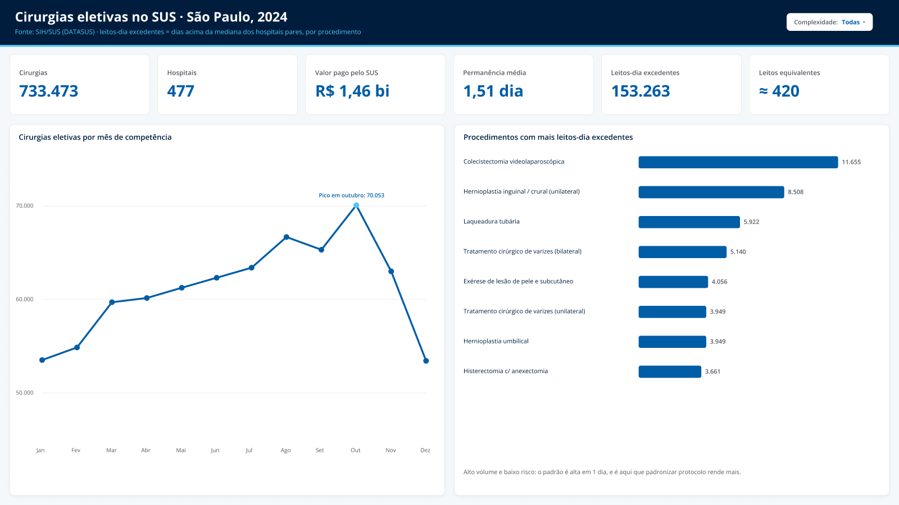
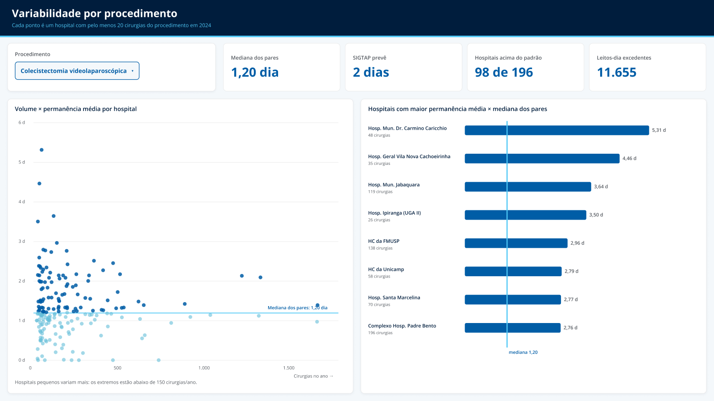
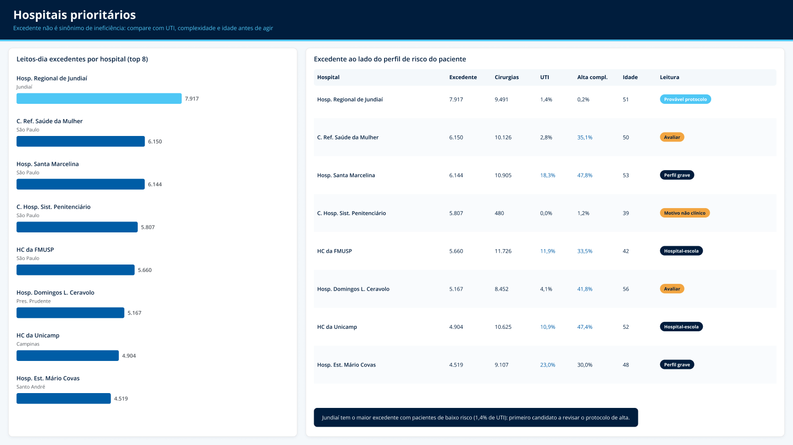

# Variabilidade de permanência em cirurgias eletivas do SUS

Produto de dados que mostra onde o SUS de São Paulo perde capacidade cirúrgica: para o mesmo procedimento, hospitais mantêm o paciente internado por tempos muito diferentes. Feito com dados públicos do DATASUS, do discovery ao painel.



## O que os dados mostram

São Paulo, 2024: **733.473 cirurgias eletivas** em **477 hospitais**, **R$ 1,46 bi** pagos pelo SUS.

- **A variação é grande em cirurgias simples.** Na hernioplastia inguinal, a permanência média vai de 0 a 25 dias entre hospitais; o hospital típico dá alta em 1 dia. Na colecistectomia por vídeo, 98 de 196 hospitais ficam acima da mediana dos pares (1,2 dia).
- **O excedente é grande.** Se cada hospital operasse na mediana dos seus pares, o estado liberaria **~153 mil leitos-dia por ano, o equivalente a ~420 leitos**.
- **E é concentrado.** 20 hospitais respondem por **51%** do excedente, em procedimentos de alto volume (vesícula, hérnia, laqueadura, varizes).
- **Mas parte dele é perfil de paciente.** Os 20 hospitais do topo têm mais UTI (6,5% × 2,3%), mais alta complexidade (29% × 18%) e pacientes mais velhos. Por isso o painel nunca mostra o excedente sozinho.

## O que dá para decidir

| Pergunta | O que o painel mostra |
|---|---|
| Por onde começar? | O Hospital Regional de Jundiaí tem o maior excedente do estado com pacientes de baixo risco (1,4% de UTI): é o primeiro candidato a revisar o protocolo de alta. |
| Qual protocolo padronizar? | Colecistectomia e hérnia: alto volume, baixo risco, padrão de 1 dia. |
| Qual a meta? | Leitos-dia liberados, com óbito e UTI como guarda-corpos. |
| O que não fazer? | Ranquear ou punir hospitais sem olhar o perfil de quem eles atendem. |

## Como o produto foi construído

| Etapa | Ferramenta | Entrega |
|---|---|---|
| Discovery | Python (pandas) | Coleta do SIH/SUS, enriquecimento com SIGTAP e CNES, definição da métrica |
| Especificação | Confluence | PRD com personas, hipóteses, requisitos e critérios de aceite ([cópia em docs/PRD.md](docs/PRD.md)) |
| Backlog | Jira | Épicos de discovery, v1, validação e v2; histórias de usuário com critérios de aceite |
| Painel | Power BI | Modelo estrela, 15 medidas DAX, 3 páginas, gerado como projeto `.pbip` por script |
| Protótipo | Figma | Próxima iteração do painel, com a leitura recomendada por hospital |

### Decisões que mudaram o resultado

- **A métrica certa é tempo de leito, não custo.** No SUS o valor pago é tabelado, então o custo quase não varia entre hospitais. O que varia, e o que trava a fila, é o leito ocupado.
- **Comparar hospital com hospital, não paciente com mediana.** Medir cada paciente contra a mediana dava 49% de "excedente", porque a variação natural entre pacientes inflava o número. A comparação usa a média de cada hospital contra a mediana dos hospitais pares, com no mínimo 20 cirurgias do procedimento.
- **Tirar os códigos guarda-chuva.** Os dois procedimentos mais frequentes ("cirurgias múltiplas" e "sequenciais em oncologia") agrupam cirurgias diferentes e não têm permanência definida na SIGTAP. Ficaram fora do benchmark, que cobre 225 procedimentos e 81% das cirurgias.

## As três páginas

| Variabilidade por procedimento | Hospitais prioritários |
|---|---|
|  |  |

As imagens são do protótipo no Figma, que reproduz o painel do Power BI e adiciona a etiqueta de leitura por hospital a ser validada com usuários.

## Como reproduzir

Requer Python 3.12 e Power BI Desktop.

```bash
python -m venv .venv
.venv\Scripts\activate
pip install -r requirements.txt

python scripts/01_baixar_sih.py SP 2024     # baixa e filtra o SIH/SUS (~200 MB, alguns minutos)
python scripts/02_modelo_estrela.py SP 2024 # monta as tabelas do painel em powerbi/data/
python scripts/03_gerar_pbip.py             # gera o projeto Power BI
```

O script 02 precisa de dois arquivos públicos em `data/aux/`:
- `sigtap.zip`: [Tabela Unificada SIGTAP](ftp://ftp2.datasus.gov.br/pub/sistemas/tup/downloads/) (competência 2024-12)
- `cnes_base.zip`: [Base de dados CNES](ftp://ftp.datasus.gov.br/cnes/) (`BASE_DE_DADOS_CNES_202412.ZIP`)

Depois, abra `powerbi/cirurgias_eletivas.pbip` e clique em **Atualizar**. Se a pasta do projeto for outra, ajuste o parâmetro `PastaDados` em Transformar dados → Gerenciar parâmetros.

Os dados não estão no repositório (~1 GB), mas são públicos e os scripts os reproduzem.

## Limitações

- O período é por competência (mês de faturamento), não pela data da cirurgia.
- O SIH registra só quem foi operado: não mede a fila de espera.
- Sem readmissão em 30 dias, que exigiria ligar internações do mesmo paciente. Está no backlog da v2, junto com o ajuste estatístico por risco.

## Fontes

- [SIH/SUS: Sistema de Informações Hospitalares](https://datasus.saude.gov.br/acesso-a-informacao/producao-hospitalar-sih-sus/), DATASUS
- [SIGTAP: Tabela de procedimentos do SUS](http://sigtap.datasus.gov.br/)
- [CNES: Cadastro Nacional de Estabelecimentos de Saúde](https://cnes.datasus.gov.br/)
